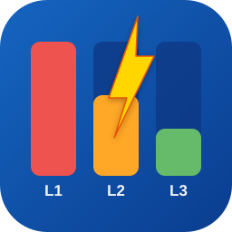

<div align="center">
  
  <h1>Dynamic Load Balancer</h1>
  <p>A Home Assistant custom integration that prevents electrical overloads in residential three-phase power systems by automatically throttling EV chargers and toggling high-power devices when a phase exceeds its fuse capacity.</p>

  <a href="https://www.buymeacoffee.com/anttibay" target="_blank">
    
  </a>
</div>

---

## What It Does

The integration monitors per-phase current every 5 seconds. When a phase exceeds the configured trigger threshold for a sustained period it:

1. **Reduces EV / charging current**: steps it down using a `number` entity (works with any EVSE: Tesla Wall Connector, Wallbox, go-e Charger, etc.)
2. **Turns off selected devices** (water heaters, climate units, switches, …) in the order you list them, if throttling the charger alone is not enough
3. **Sends a notification** to the HA dashboard and optionally to your phone
4. **Restores everything automatically**: cautiously ramps load back up once all phases have enough headroom

Everything is configured through the UI: no YAML needed, and every setting can be changed later without re-adding the integration.

## Installation via HACS

1. In Home Assistant, go to **HACS → Integrations → ⋮ → Custom repositories**
2. Add this repository URL and select category **Integration**
3. Install **Dynamic Load Balancer** from the HACS store
4. Restart Home Assistant
5. Go to **Settings → Devices & Services → Add Integration** and search for *Dynamic Load Balancer*

## Manual Installation

Copy the `custom_components/dynamic_load_balancer` folder into your Home Assistant `config/custom_components/` directory and restart.

## Configuration

### Setup wizard

Setup is done through the UI wizard (4 steps):

| Step | What you configure |
|---|---|
| 1. Panel capacity | Per-phase fuse / breaker size in Amperes |
| 2. Current sensors | Sensor entities that report current (A or mA) per phase |
| 3. Reaction behavior | Aggressiveness level, spike-filter duration, restore headroom |
| 4. Actions & notifications | EV charger entity, devices to toggle, notification device |

### Changing settings later

Open **Settings → Devices & Services → Dynamic Load Balancer → Configure** and pick a group of settings. Changes apply immediately, and any reduction or restoration in progress carries on without interruption.

| Menu | Settings |
|---|---|
| Fuse size & reaction thresholds | Fuse size, aggressiveness, spike filter, restore headroom |
| Current sensors | Phase sensors and which phases are monitored |
| EV charger & devices | Charger entity, devices to toggle, estimated load per device, restore priority |
| Notifications | On/off, phone to notify, notify when load is restored |
| Advanced timing | Settle time, time between restore steps, time between reductions, extra charger reduction |

### Live controls on the device page

The most-used settings are also entities on the **Dynamic Load Balancer** device page, so you can change them from a dashboard or an automation. Changes are saved and show up in the Configure dialog too.

| Entity | Type | Use |
|---|---|---|
| Aggressiveness | Select | Switch between Very Low … Very High |
| Fuse size | Number | Per-phase limit in A |
| Spike filter | Number | Seconds an overload must last |
| Restore headroom | Number | Free capacity needed before restoring |
| Notifications | Switch | Mute / unmute notifications |

Example: be more protective during peak-tariff hours.

```yaml
automation:
  - alias: "Load balancer: protective during peak hours"
    triggers:
      - trigger: time
        at: "07:00:00"
    actions:
      - action: select.select_option
        target:
          entity_id: select.dynamic_load_balancer_aggressiveness
        data:
          option: very_high
  - alias: "Load balancer: normal outside peak hours"
    triggers:
      - trigger: time
        at: "22:00:00"
    actions:
      - action: select.select_option
        target:
          entity_id: select.dynamic_load_balancer_aggressiveness
        data:
          option: medium
```

## Aggressiveness Levels

| Level | Trigger threshold | Example (25 A fuse) |
|---|---|---|
| Very Low | 100 % of fuse | 25.0 A |
| Low | 95 % of fuse | 23.75 A |
| Medium (default) | 90 % of fuse | 22.5 A |
| High | 85 % of fuse | 21.25 A |
| Very High | 80 % of fuse | 20.0 A |

## Entities Created

| Entity | Type | Description |
|---|---|---|
| Dynamic Load Balancer | Switch | Enable / disable load balancing. Turning it off restores all reduced load immediately |
| Status | Sensor (enum) | Monitoring, Overload detected, Reducing load, Waiting for headroom, Settling, Restoring, Disabled, Sensor unavailable |
| Available headroom | Sensor (A) | Smallest free capacity across monitored phases (per-phase values as attributes) |
| Trigger threshold | Sensor (A) | Current at which a phase counts as overloaded |
| Overload events | Sensor | Number of overload events (long-term statistics friendly) |
| Last overload | Sensor (timestamp) | Date & time of the last overload event, with phases and peak current as attributes |
| Overload | Binary sensor | On while any monitored phase is above the trigger threshold |
| Load reduced | Binary sensor | On while the charger is throttled or devices are held off |
| Restore load now | Button | Restore everything immediately, skipping the gradual ramp-up |
| Aggressiveness, Fuse size, Spike filter, Restore headroom, Notifications | Config | See *Live controls* above |

The master switch also keeps its detailed state attributes (phase currents, trigger threshold, managed devices, status) for existing automations.

## Load Reduction

1. The charger is reduced first by *overload + extra charger reduction* (2 A by default), snapped down to the charger's step size and never below its minimum.
2. If that is not enough, devices are turned off **in the order you listed them**, assuming each frees the *estimated load per device* (5 A by default).
   - **Climate** entities are set to HVAC mode `off` and later get their previous mode back (e.g. `heat`).
   - **Water heaters** are set to operation mode `off` (if supported) and later get their previous mode back (e.g. `eco`).
   - **Switches, fans, input booleans** are simply turned off and on.
3. Reductions are spaced at least 10 s apart (configurable) so the charger has time to react.

Tip: as a last resort you can add your EVSE's *charging enable* switch at the end of the devices list.

## Smart Restoration

After reducing load, the integration does **not** immediately ramp back up. It waits until:
1. All phases have at least the **restore headroom** (3 A by default) below the trigger threshold
2. That headroom has been **stable for the settle time** (60 s by default)
3. Then it restores **one step at a time**, waiting the **restore step time** (60 s by default) between steps

Each step must leave the restore headroom intact:
- **Charger**: one step up (e.g. +1 A) needs *step + restore headroom* of free capacity. If there is not enough room it waits, and resumes once the house load drops. The original charging current is never forgotten.
- **Devices**: turned back on in reverse order (last off, first on), each needing *estimated load per device + restore headroom* of free capacity.

The **restore priority** decides which comes first: *EV charger first* (default) or *Devices first*. The other waits until the first is fully restored.

This prevents the oscillation (reduce → restore → overload → repeat) common with simpler load managers. Restoration state is saved, so a Home Assistant restart or a settings change in the middle of an overload never leaves a device switched off. If you delete the integration while load is reduced, it is restored first.

## Notifications

When an overload is detected the integration creates a **persistent notification** in the Home Assistant dashboard (bell icon). To also receive a **push notification on your phone**, select your mobile device during setup or in the options dialog. Only devices with the Home Assistant companion app installed will appear.

Optionally (*Notify when load is restored*), you also get a message once the overload is over and everything is back. On your phone it replaces the overload alert.

A new overload more than 5 minutes after the previous one is reported again, even if the earlier load is still being restored.

## Dashboard Example

```yaml
type: entities
title: Load balancer
entities:
  - entity: switch.dynamic_load_balancer
  - entity: sensor.dynamic_load_balancer_status
  - entity: sensor.dynamic_load_balancer_available_headroom
  - entity: binary_sensor.dynamic_load_balancer_load_reduced
  - entity: select.dynamic_load_balancer_aggressiveness
  - entity: button.dynamic_load_balancer_restore_load_now
```

(Entity IDs may differ if you renamed the device or upgraded from an older version.)

## Troubleshooting

- **Settings → Devices & Services → Dynamic Load Balancer → ⋮ → Download diagnostics** gives a snapshot of the configuration and current state, useful for bug reports.
- If a phase sensor becomes unavailable, load management pauses (Status: *Sensor unavailable*) rather than acting on incomplete data.

## Requirements

- Home Assistant 2025.1 or newer
- At least one current sensor per phase (e.g. Shelly EM, Eastron SDM, smart meter integration)
- Optional: an EVSE that exposes a charging-current `number` entity
- Optional: a mobile device with the Home Assistant companion app installed

## Development

```bash
pip install -r requirements_test.txt
pytest
```

---

<div align="center">
  <p>If this integration saves your fuse, consider buying me a coffee ☕</p>
  <a href="https://www.buymeacoffee.com/anttibay" target="_blank">
    
  </a>
</div>
